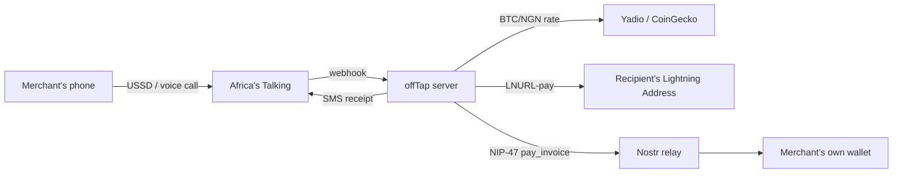

# offTap

Lightning payments in Hausa over USSD and voice, for merchants in Northern Nigeria whose mobile data is unreliable. Payments are made from the merchant's own wallet through Nostr Wallet Connect (NIP-47).

## The problem

Traders in markets like Kantin Kwari and Dawanau lose sales when bank transfers and POS terminals go down, and POS agents charge on every transaction. Lightning fixes the cost and the downtime, but every Lightning wallet needs a smartphone with working data and is written in English. When the data drops, the merchant is stuck.

## How it works

A merchant links their wallet once, while they have data. After that they can pay from any phone signal, in Hausa, by dialling a USSD code or making a voice call.



1. The merchant creates an NWC connection in their wallet, limited to `pay_invoice` and `get_balance` with a daily budget, and links it to their phone number.
2. They dial the USSD code, choose **Tura Kudi**, enter the recipient and an amount in naira, and confirm with a PIN.
3. offTap converts naira to sats at the live rate, fetches an invoice from the recipient's Lightning Address, and asks the merchant's wallet to pay it over NWC.
4. An SMS receipt is sent.

## Custody model

offTap never holds wallet keys or funds. It holds an NWC connection string that can only spend up to the daily budget the merchant set in their own wallet, and the merchant can revoke it from the wallet at any time. The worst case if the offTap server is compromised is the loss of one day's budget per linked wallet, not the wallet balance. A full threat model will be added in `docs/`.

## Status

| Piece | State |
|---|---|
| NWC client (balance, pay invoice, budget check) | Done |
| Lightning Address resolver with amount verification | Done |
| BTC/NGN rate with fallback source | Done |
| USSD menu in Hausa, wallet linking, SMS receipts | In progress |
| Hausa voice commands | Planned |

## Run it

```bash
docker compose up --build
curl "http://localhost:3000/quote?ngn=5000"
```

Or without Docker (Node 22+):

```bash
npm install
npm run dev
```

## Try a payment from the command line

Create an NWC connection in your wallet (for example Alby Hub) with a small budget, then:

```bash
export NWC_URI='nostr+walletconnect://...'
npm run cli -- wallet                      # what the connection is allowed to do
npm run cli -- balance
npm run cli -- quote 5000                  # naira to sats
npm run cli -- pay name@example.com 500    # pay NGN 500 to a Lightning Address
```

## Tests

```bash
npm test
```

## Licence

MIT
