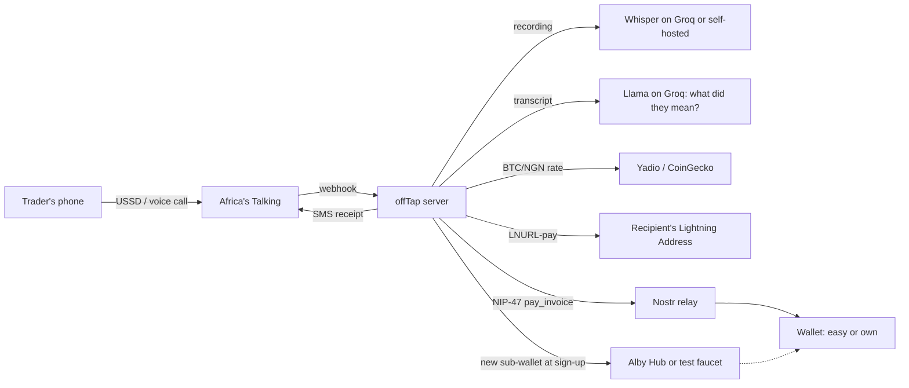

<p align="center"></p>

# offTap

Lightning payments in Hausa over USSD and voice, for traders in Northern Nigeria whose bank network and mobile data keep failing. Every wallet is driven through Nostr Wallet Connect (NIP-47), whether offTap opened it for you or you brought your own.

## The problem

Traders in markets like Kantin Kwari and Dawanau lose sales when bank transfers and POS terminals go down, and POS agents charge on every transaction. Lightning fixes the cost and the downtime, but every Lightning wallet needs a smartphone with working data and is written in English. When the data drops, the merchant is stuck.

## How it works

A trader dials the USSD code and gets a wallet in under a minute. No smartphone, no data, no app.

1. Dial the code, choose **Bude sabon wallet** and pick a 4-digit PIN. The wallet is ready.
2. To pay, choose **Tura Kudi**, enter a phone number or Lightning address (or pick a saved name) and an amount in naira.
3. offTap shows the amount in sats at the live rate. The trader confirms with their PIN.
4. The payment settles over Lightning and both sides get an SMS.

### Getting money in

Every easy wallet has a Lightning address made from its phone number, served by offTap itself:

```
2348051234567@your-offtap-host
```

Anyone with any Lightning wallet, anywhere, can pay it. The sats land in the trader's wallet and they get an SMS. The trader finds the address under **Karbi Kudi**. Other offTap users just send to the phone number.

### By voice

Typing on a keypad is slow and not everyone reads. A trader can save the people they pay under a name (**Lambobina** in the menu), then call in and say it:

> "Tura dubu biyar zuwa Musa"

Three steps turn speech into a payment, and each one is checked by the next:

1. **Whisper** turns the recording into Hausa text.
2. **A language model** (Llama 3.3 on Groq) works out what the trader meant, even when the sentence is loosely worded or misheard. A small Hausa rule parser handles the clear sentences on its own and always decides the amount when it can read one, because number words should not be left to a model's judgement.
3. **The trader** hears it read back ("Za ka tura naira dubu biyar zuwa Musa") and approves by entering their PIN on the keypad.

The PIN is never spoken. Whatever the models say, voice only pays saved contacts, and a name that does not clearly match one is refused rather than guessed.

### Two kinds of wallet

| | Easy wallet | Own wallet |
|---|---|---|
| Set up | Entirely over USSD | Link an NWC connection on a web page |
| Funds are held | On the offTap operator's Lightning node, in a separate sub-wallet per user | In the merchant's own wallet |
| For | Anyone with any phone | Merchants who want full control |

Both use the same menu, the same phone number and the same PIN flow. A trader can start with the easy wallet and switch to their own from the menu (**Saita Wallet**) at any time.

## Architecture



| Layer | Technology | Code |
|---|---|---|
| Telecom gateway | Africa's Talking USSD, SMS and voice | [src/ussd/](src/ussd/), [src/sms.ts](src/sms.ts) |
| Wallet linking | Web form, one-time code, PIN-sealed storage | [src/web/link.ts](src/web/link.ts), [src/vault.ts](src/vault.ts) |
| Easy wallets | NWC faucet for testing, Alby Hub sub-wallets for real sats | [src/wallets/provider.ts](src/wallets/provider.ts) |
| Storage | SQLite | [src/db.ts](src/db.ts) |
| Server | Node.js, TypeScript, Fastify | [src/server.ts](src/server.ts) |
| Payment flow | Naira quote, invoice, pay | [src/payments.ts](src/payments.ts) |
| Wallet access | Nostr Wallet Connect (NIP-47) via `@getalby/sdk` | [src/lightning/nwc.ts](src/lightning/nwc.ts) |
| Recipient lookup | Lightning Address (LNURL-pay) | [src/lightning/lnaddress.ts](src/lightning/lnaddress.ts) |
| Receiving from outside | A Lightning address per phone number (LNURL-pay server), SMS on arrival | [src/lightning/lnurlp.ts](src/lightning/lnurlp.ts) |
| Rate oracle | Yadio, CoinGecko fallback, 60s cache | [src/rates.ts](src/rates.ts) |
| Contacts | Saved names per phone | [src/contacts.ts](src/contacts.ts) |
| Voice understanding | Hausa number words and send/balance intents, no model needed | [src/voice/numbers.ts](src/voice/numbers.ts), [src/voice/intent.ts](src/voice/intent.ts) |
| Voice calls | Africa's Talking Voice, read-back, keypad PIN | [src/voice/call.ts](src/voice/call.ts), [src/voice/routes.ts](src/voice/routes.ts) |
| Speech-to-text | Whisper large v3 on Groq, or any self-hosted Whisper-compatible server | [src/voice/speech.ts](src/voice/speech.ts) |
| AI understanding | Llama 3.3 70B on Groq (or any OpenAI-compatible model), strict JSON, rule parser as check and fallback | [src/voice/understand.ts](src/voice/understand.ts) |
| Shared rules | PIN check, limits and payment, used by both USSD and voice | [src/actions.ts](src/actions.ts) |
| Demo | Seeded traders and a browser phone simulator | [src/seed.ts](src/seed.ts), [src/web/sim.ts](src/web/sim.ts) |

The offTap server never talks to a Lightning node directly. Every wallet, easy or own, is reached through a Nostr relay with an NWC connection. For an own wallet the merchant issued that connection and the funds stay with them. For an easy wallet the operator's node issued it at sign-up and holds the funds.

## Custody and security

**The easy wallet is custodial.** The operator of the offTap server holds the funds, the same as existing USSD Bitcoin services. It exists because asking a market trader to run a Lightning node is not realistic. Keep small amounts in it.

**The own wallet is not.** offTap holds only an NWC connection string that can spend up to the budget the merchant set in their wallet, and the merchant can revoke it there at any time. The worst case is the loss of that budget, not the wallet balance.

In both modes:

- **Phone ownership is proven by the SIM.** Sign-up and link codes are issued inside a USSD session, so only the person holding the SIM can create or attach a wallet for that number.
- **Connections are encrypted at rest** with AES-256-GCM. For own wallets the key is derived from the PIN and a server secret (scrypt), and the connection is decrypted only for the moment of a payment.
- **Three wrong PINs lock the account for an hour.** Obvious PINs such as 1234 or 1111 are refused.
- **Server-side limits.** A cap per payment and per 24 hours applies on top of any wallet budget.
- **Voice follows the same rules.** A call goes through the same PIN check, lockout and limits as USSD. The PIN is typed, not spoken, and only saved contacts can be paid.
- **The amount is fixed at confirmation.** The trader sees naira and sats before entering the PIN, and the invoice is checked against that amount.
- **Nothing sensitive is logged.** Request bodies, phone numbers and PINs are kept out of logs.

The full list of threats, what limits each one, and what is still unsolved is in the [threat model](docs/threat-model.md).

What this does not protect against: a 4-digit PIN travels through the mobile network and the server in the clear, so an offTap operator could spend from an easy wallet, or up to the budget of a linked one. Run your own server or use one you trust.

## Status

| Piece | State |
|---|---|
| NWC client (balance, pay invoice, budget check) | Done |
| Lightning Address resolver with amount verification | Done |
| BTC/NGN rate with fallback source | Done |
| Hausa USSD menu: send, balance, receive, link wallet | Done |
| Sign-up over USSD with an easy wallet (test sats or Alby Hub sub-wallets) | Done |
| Wallet linking with a one-time code and PIN | Done |
| SMS receipts through Africa's Talking | Done, not yet tested against a live account |
| Built-in phone simulator with demo traders and seed data | Done |
| Lightning address per phone number, so outside wallets can pay in | Done, tested live between test wallets |
| Saved contacts, pay by name | Done |
| Hausa voice: number words, intent, call flow, read-back, keypad PIN | Done, tested with typed speech and live test payments |
| Speech-to-text on real recordings | Working with Whisper on Groq, tried with spoken Hausa in the simulator |
| AI understanding of loosely worded or misheard sentences | Done, tested with a stand-in model; not yet measured on real traders' speech |
| Africa's Talking voice webhook | Written, not yet tested on a live number |
| Public demo mode: simulator limited to practice numbers, next to real phones | Done |
| Threat model and deployment guide | Done |
| Hausa text-to-speech on calls | Not yet: prompts are sent as text for Africa's Talking to speak |

## Run it

```bash
docker compose up --build
```

Then open http://localhost:3000/sim. It shows two phones side by side that talk to the server the same way Africa's Talking does. Each phone has USSD, voice and an SMS inbox, so you can send from one and watch the message arrive on the other.

On first start the server creates three demo traders, each with a test wallet holding 10,000 test sats (no real value), with each other saved as contacts and two payments already made between them. This takes about half a minute and needs internet, since the wallets and payments are real ones on a test network.

| Trader | Phone | PIN |
|---|---|---|
| Amina | +2348030000001 | 4826 |
| Musa | +2348030000002 | 7391 |
| Aisha | +2348030000003 | 5802 |

1. **Pay over USSD.** The left phone is Amina, the right is Musa. On Amina's phone press **Dial**, choose `1` to send, pick Musa from the list, enter an amount in naira, then her PIN. Musa's phone shows the SMS.
2. **Check a balance.** On Musa's phone dial, choose `2`, enter his PIN.
3. **Pay by voice.** Open the **Voice** tab, press **Call**, type `tura dari biyar zuwa Aisha`, and enter the PIN when asked.
4. **Sign up from scratch.** Choose **Another number** at the top of a phone, dial, choose `1`, and pick a PIN.

Set `SEED_DEMO=false` to start empty. Demo data is only created with test wallets, never when wallets hold real sats, and not when Africa's Talking keys are set unless you turn on the public demo (below).

To link your own wallet instead, choose `2` on the first screen and follow the link code to http://localhost:3000/link.

Without Docker (Node 22.13+):

```bash
npm install
npm run dev
```

### With Africa's Talking

Copy `.env.example` to `.env`, set `AT_USERNAME` and `AT_API_KEY`, and point your USSD channel's callback URL at `https://<your-host>/ussd`. Setting these sends real SMS and turns the simulator off. Set `PUBLIC_DEMO=true` to keep the simulator, limited to practice numbers that real phones cannot use.

To put it on a public address, see [docs/deploy.md](docs/deploy.md).

### With speech

The simulator takes typed sentences by default. To speak instead, give offTap a speech-to-text service. Two options:

- **Groq (quickest).** Set `GROQ_API_KEY` in `.env`. Recordings are transcribed by Whisper large v3 on Groq, and the same key turns on the language model that interprets unclear sentences.
- **Self-hosted.** Run the open-source speech server from the compose file, so audio never leaves your machine:

  ```bash
  STT_URL=http://speech:8000/v1/audio/transcriptions docker compose --profile voice up --build
  ```

Either way the recogniser is told to expect Hausa, given the number words and the caller's saved contact names as hints, and its output still has to pass the same parser, contact match, read-back and PIN. With Groq, the recording, the transcript and those names are sent to Groq; nothing else is. No phone number, PIN or balance leaves the server. `LLM_URL` and `LLM_MODEL` point the understanding step at a different or self-hosted model.

To check a recording from the command line:

```bash
npm run cli -- hear recording.m4a Musa Aisha
```

For phone calls, point your Africa's Talking voice number's callback URL at `https://<your-host>/voice`. Calls from Africa's Talking are not yet tested on a live number.

### With real sats

The compose file includes [Alby Hub](https://github.com/getAlby/hub), an open-source Lightning node. Start it alongside offTap:

```bash
docker compose --profile wallet up --build
```

Open http://localhost:8080, set it up and fund it. Then either:

- **Easy wallets on your hub:** create an API token in the hub, and set `WALLET_PROVIDER=albyhub` and `ALBY_HUB_TOKEN` in `.env`. Each sign-up gets its own isolated sub-wallet.
- **Your own wallet:** under Connections create one for offTap with only "pay invoices" and "read balance" enabled and a daily budget, and paste it into the link page.

## Try it without real money

Alby runs a faucet that hands out NWC wallets filled with test sats. They behave like real wallets but hold no value, and they can pay each other.

```bash
npm run cli -- test-wallet          # prints a Lightning address and an NWC_URI line
npm run cli -- test-wallet 1000     # a second one to receive
```

Paste the first `NWC_URI=...` line into `.env` (or into the link page), then pay the second wallet's Lightning address:

```bash
npm run cli -- wallet                        # what the connection is allowed to do
npm run cli -- balance
npm run cli -- quote 5000                    # naira to sats
npm run cli -- pay <lightning-address> 500   # pay NGN 500
```

With a real wallet the commands are the same; only the connection string changes.

## Tests

```bash
npm test
```

121 tests cover the money maths, PIN vault, USSD flows, contacts, Hausa numbers and intents, the AI understanding step and its limits, receiving from outside wallets, the voice call flow, the webhooks, demo seeding and the public demo restrictions. They run without network access.

## More

- [Threat model](docs/threat-model.md): what is protected, from whom, and what is not
- [Deploying](docs/deploy.md): hosting requirements, settings and Africa's Talking callback URLs
- [Original concept brief](docs/project-brief.md): where the idea started, with notes on what changed

## Licence

MIT
