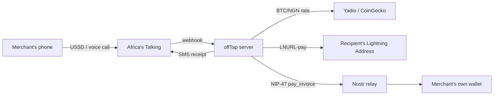

# offTap

Lightning payments in Hausa over USSD and voice, for merchants in Northern Nigeria whose mobile data is unreliable. Payments are made from the merchant's own wallet through Nostr Wallet Connect (NIP-47).

## The problem

Traders in markets like Kantin Kwari and Dawanau lose sales when bank transfers and POS terminals go down, and POS agents charge on every transaction. Lightning fixes the cost and the downtime, but every Lightning wallet needs a smartphone with working data and is written in English. When the data drops, the merchant is stuck.

## How it works

A merchant links their wallet once, while they have data. After that they can pay from any phone signal, in Hausa, by dialling a USSD code or making a voice call.

1. The merchant creates an NWC connection in their wallet, limited to `pay_invoice` and `get_balance` with a daily budget, and links it to their phone number.
2. They dial the USSD code, choose **Tura Kudi**, enter the recipient and an amount in naira, and confirm with a PIN.
3. offTap converts naira to sats at the live rate, fetches an invoice from the recipient's Lightning Address, and asks the merchant's wallet to pay it over NWC.
4. An SMS receipt is sent.

## Architecture



| Layer | Technology | Code |
|---|---|---|
| Telecom gateway | Africa's Talking USSD and SMS | [src/ussd/](src/ussd/), [src/sms.ts](src/sms.ts) |
| Wallet linking | Web form, one-time code, PIN-sealed storage | [src/web/link.ts](src/web/link.ts), [src/vault.ts](src/vault.ts) |
| Storage | SQLite | [src/db.ts](src/db.ts) |
| Server | Node.js, TypeScript, Fastify | [src/server.ts](src/server.ts) |
| Payment flow | Naira quote, invoice, pay | [src/payments.ts](src/payments.ts) |
| Wallet access | Nostr Wallet Connect (NIP-47) via `@getalby/sdk` | [src/lightning/nwc.ts](src/lightning/nwc.ts) |
| Recipient lookup | Lightning Address (LNURL-pay) | [src/lightning/lnaddress.ts](src/lightning/lnaddress.ts) |
| Rate oracle | Yadio, CoinGecko fallback, 60s cache | [src/rates.ts](src/rates.ts) |
| Voice | Hausa speech recognition and intent parsing | planned |

The server is the only component offTap runs. The wallet stays with the merchant, and the server reaches it through a Nostr relay using the connection the merchant issued.

## Custody and security

offTap never holds wallet keys or funds. It holds an NWC connection string that can only spend up to the budget the merchant set in their own wallet, and the merchant can revoke it from the wallet at any time.

- **Linking proves phone ownership.** The link code is issued inside a USSD session, so only the person holding the SIM can attach a wallet to that number.
- **The connection string is sealed with the PIN.** It is encrypted with AES-256-GCM under a key derived from the PIN and a server secret (scrypt). It is decrypted only for the moment of a payment.
- **Three wrong PINs lock the account for an hour.**
- **Server-side limits.** A cap per payment and per 24 hours applies on top of the wallet budget.
- **The amount is fixed at confirmation.** The merchant sees naira and sats before entering the PIN, and the invoice returned by the recipient is checked against that amount.
- **Nothing sensitive is logged.** Request bodies, phone numbers and PINs are kept out of logs.

What this does not protect against: a 4-digit PIN travels through the mobile network and the server in the clear, so the operator of an offTap server could spend up to the wallet budget. The budget is the real limit on loss. Run your own server or use one you trust, and keep the budget small.

## Status

| Piece | State |
|---|---|
| NWC client (balance, pay invoice, budget check) | Done |
| Lightning Address resolver with amount verification | Done |
| BTC/NGN rate with fallback source | Done |
| Hausa USSD menu: send, balance, receive, link wallet | Done |
| Wallet linking with a one-time code and PIN | Done |
| SMS receipts through Africa's Talking | Done, not yet tested against a live account |
| Built-in phone simulator | Done |
| Hausa voice commands | Planned |

## Run it

```bash
docker compose up --build
```

Then open http://localhost:3000/sim. It is a phone simulator that talks to the server the same way Africa's Talking does, with an SMS inbox underneath.

1. Press **Dial**, choose `1` to get a link code.
2. Open http://localhost:3000/link, enter the code, an NWC connection string from your wallet, and a 4-digit PIN.
3. Dial again: `1` to send, enter a Lightning address or a linked phone number, an amount in naira, then your PIN.
4. The receipt appears in the SMS inbox.

Without Docker (Node 22.13+):

```bash
npm install
npm run dev
```

### With Africa's Talking

Copy `.env.example` to `.env`, set `AT_USERNAME` and `AT_API_KEY`, and point your USSD channel's callback URL at `https://<your-host>/ussd`. Setting these turns the simulator off and sends real SMS.

## Try a payment from the command line

Create an NWC connection in your wallet (for example Alby Hub) with a small budget, then:

```bash
export NWC_URI='nostr+walletconnect://...'
npm run cli -- wallet                      # what the connection is allowed to do
npm run cli -- balance
npm run cli -- quote 5000                  # naira to sats
npm run cli -- pay name@example.com 500    # pay NGN 500 to a Lightning Address
```

## Tests

```bash
npm test
```

## Licence

MIT
